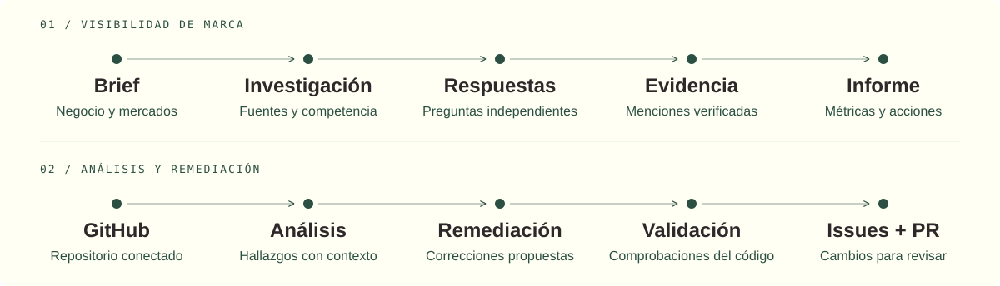
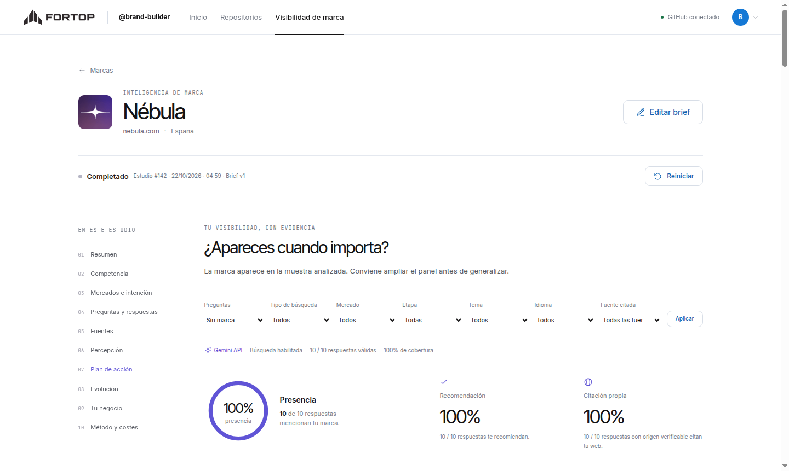
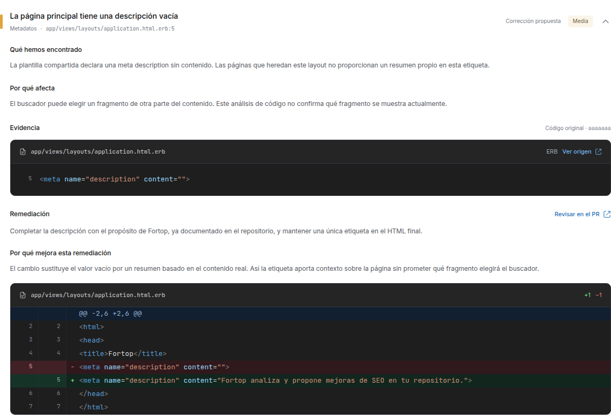

<p align="center">
  
</p>

<p align="center">
  <a href="https://fortop.34-76-10-0.sslip.io"><strong>Abrir Fortop ↗</strong></a> ·
  <a href="docs/README.md">Documentación</a> ·
  <a href="fortop_pitch/Fortop-Pitch.pdf">Pitch</a> ·
  <a href="docs/desarrollo.md">Ejecutar en local</a>
</p>

Fortop ayuda a entender **cuándo se recomienda una marca** y a **corregir problemas técnicos de su web**. Une estudios de visibilidad con evidencia y agentes que proponen cambios revisables en GitHub.

## Dos formas de mejorar tu presencia

| Visibilidad de marca | Análisis y remediación |
| :--- | :--- |
| Parte de un brief o de tus documentos. | Parte de un repositorio conectado con GitHub. |
| Investiga negocio, público, mercados y competidores. | Explora el código, contrasta problemas y prepara correcciones. |
| Mide menciones, recomendaciones y fuentes en respuestas de Gemini. | Valida los cambios y abre issues y pull requests. |
| **Resultado:** informe persistente con métricas, evidencia y acciones. | **Resultado:** hallazgos explicados, diffs y PRs para revisar. |



Los dos recorridos funcionan por separado. Una acción técnica del informe puede enviarse a un repositorio para que los agentes la comprueben contra el código.

## El producto

<table>
  <tr>
    <td width="50%"><a href="docs/assets/brand-report.png"></a></td>
    <td width="50%"><a href="docs/assets/code-finding.png"></a></td>
  </tr>
  <tr>
    <td><strong>Entender dónde apareces.</strong><br>Respuestas, competidores, fuentes y evolución.</td>
    <td><strong>Revisar qué cambia y por qué.</strong><br>Problema, impacto, evidencia y corrección.</td>
  </tr>
</table>

*Capturas de la aplicación con datos de prueba. [Recorrido del producto →](docs/producto.md)*

## Cómo está construido

**Rails 8.1 · Ruby 3.3 · PostgreSQL · Hotwire · Tailwind · Solid Queue · Google Gemini · GitHub App**

Un monolito Rails sirve la web y ejecuta los trabajos en un worker separado. Los agentes usan herramientas, conservan el progreso y permiten pausar, continuar o recuperar una ejecución. La publicación en GitHub deja los cambios pendientes de revisión.

La medición actual corresponde a **Gemini API con búsqueda habilitada**. Los porcentajes describen la muestra del estudio; no representan todo el mercado ni mediciones de ChatGPT, Claude o Grok. [Método y lectura de resultados →](docs/metodologia.md)

## Arrancar en local

Necesitas Ruby **3.3.5**, Bundler y PostgreSQL. La [guía de desarrollo](docs/desarrollo.md) detalla dependencias, credenciales y autorización de usuarios.

```sh
git clone git@github.com:Guayamose/fortop.git
cd fortop/fortop_platform
cp -n .env.example .env
bundle install
bin/rails db:prepare
bin/dev
```

Abre **http://localhost:3000**. Añade tu clave de Google a `.env` y configura la [GitHub App](fortop_github_app/README.md). El acceso exige autorización, también en local; el administrador se identifica por su ID de GitHub.

## Encuentra lo que necesitas

| Quiero… | Ir a |
| :--- | :--- |
| Entender los recorridos y sus resultados | [Producto](docs/producto.md) |
| Entender cómo se mide la visibilidad | [Metodología y evidencia](docs/metodologia.md) |
| Entender qué hacen los agentes sobre el código | [Agentes de repositorios](docs/agentes.md) |
| Ver componentes, conexiones y despliegue | [Arquitectura y C4](docs/arquitectura.md) |
| Instalar, configurar y ejecutar pruebas | [Desarrollo](docs/desarrollo.md) |
| Administrar accesos, consumo, despliegues y copias | [Operación](docs/operacion.md) |
| Presentar el proyecto o usar su identidad | [Pitch](fortop_pitch/README.md) · [Brand kit](fortop_brand_kit/README.md) · [Entregables](docs/entregables.md) |

## Dentro del repositorio

```text
fortop/
├── fortop_platform/     Aplicación, agentes, pruebas e infraestructura
├── fortop_github_app/   Manifiesto, registro y avatar de la integración
├── fortop_brand_kit/    Identidad, manual y originales vectoriales
├── fortop_pitch/        Presentación, diapositivas y fuentes editables
├── fortop-deliverables/ Canvas, viabilidad y láminas del hackathon
└── docs/               Guías y arquitectura actual
```

El código se mantiene en **`master`**. GitHub Actions comprueba seguridad, estilo, assets y pruebas. La publicación de código en GitHub y el despliegue de la aplicación son operaciones separadas.

## Equipo

**Rafael Pradillo · Álvaro Fernández-Aller · Carlos Blázquez · Alejandro Ferreras · Jaime Poyatos**
