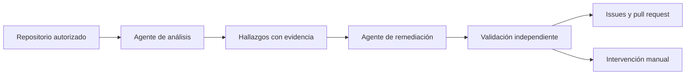

# Agentes de repositorios

[← Documentación](README.md) · [Arquitectura](arquitectura.md)

**Exploran, usan herramientas, reciben resultados y corrigen su siguiente paso.** El análisis y la remediación son dos recorridos agénticos coordinados por Rails, con Google Gemini como proveedor.

## 1 · Analizar

El agente decide qué explorar con `list_files`, `read_file` y `search`. Registra hallazgos con `report_finding`; la evidencia debe corresponder a una fuente original leída y a la línea indicada.

El cierre se comprueba contra el inventario de páginas, plantillas, componentes, rutas y archivos SEO. Mientras haya fuentes web pendientes, el agente recibe las rutas y líneas desde las que debe continuar. `defer_review` exige una razón y no cuenta el archivo como revisado.

Un hallazgo rechazado debe corregirse o descartarse con una justificación. Un defecto que no se pueda automatizar se conserva como manual.

## 2 · Remediar

El segundo agente recibe los hallazgos y puede leer, buscar, usar `replace_text` o `write_file`, validar con `validate_changes`, descartar cambios con `discard_changes` y marcar intervención manual con `mark_manual`.

Trabaja en lotes de 20 hallazgos, sin límite de lotes. Conserva los cambios anteriores y utiliza los errores de validación para corregir su propuesta. Al terminar, una verificación independiente precede a la publicación.

## 3 · Validar y publicar

| Formatos | Comprobación |
| :--- | :--- |
| Ruby, ERB, JSON, XML, HTML, texto y Markdown | Validadores específicos de formato y alcance |
| JavaScript | Parseo en Docker aislado, sin red y con recursos limitados |
| TypeScript, JSX/TSX, Vue, Svelte y otros | Análisis disponible; correcciones sin validador automático quedan para revisión manual |

No se instalan dependencias ni se ejecutan scripts, builds o suites del repositorio analizado. El PR necesita el CI y la revisión de su equipo.

Fortop conserva el árbol original, crea ramas `fortop/*` y publica con la identidad de la GitHub App. Los cambios quedan como propuestas: no se fusionan ni despliegan automáticamente.

## Cobertura y consumo

No hay cupos fijos de archivos, hallazgos o cambios. Inventarios, lecturas y búsquedas se paginan; los árboles truncados por GitHub se recuperan por subárboles. Cada archivo debe ser texto UTF-8 de hasta 1 MB.

Se excluyen credenciales, dependencias, archivos ocultos, binarios, symlinks y submódulos. También se rechazan archivos con patrones reconocibles de secretos antes de enviarlos al modelo. Ese detector es heurístico, no un escáner exhaustivo.

| Ajuste | Valor por defecto | Efecto |
| :--- | ---: | :--- |
| `AGENT_MAX_TURNS` | `0` | Sin límite de turnos |
| `AGENT_MAX_TOOL_CALLS` | `0` | Sin límite de herramientas |
| `AGENT_TIMEOUT_SECONDS` | `0` | Sin límite de duración del agente |
| `AGENT_MAX_TOTAL_TOKENS` | `0` | Sin presupuesto acumulado de tokens |
| `AGENT_MAX_OUTPUT_TOKENS` | `16384` | Salida máxima por respuesta |
| `AGENT_CONTEXT_MAX_BYTES` | `120000` | Umbral de compactación de contexto |

Los valores positivos activan límites explícitos. La compactación resume turnos antiguos y conserva los dos pares recientes de llamadas/respuestas, con sus firmas de Gemini. Sus tokens cuentan en el consumo total. No hay un tope monetario de repositorios; el panel registra tokens.

## Continuidad y fallos

- **Pausa:** guarda el progreso y se atiende en un punto seguro. Continuar recupera la ejecución.
- **GitHub transitorio:** hasta tres intentos de publicación, comprobando los recursos ya creados para evitar duplicados.
- **Token caducado:** ante un 401, vuelve a verificar acceso e identidad del repositorio antes de renovar y repetir una vez.
- **Reintentar publicación:** recupera las correcciones cifradas y las verifica de nuevo, sin repetir los agentes ni gastar IA.
- **Fallo anterior al punto de recuperación:** reintentar análisis crea una ejecución nueva con IA.
- **Sin actividad durante 30 minutos:** se señala el fallo y se ofrece recuperación. PostgreSQL evita escaneos simultáneos del mismo repositorio.

## Dónde está cada pieza

| Responsabilidad | Código |
| :--- | :--- |
| Orquestación y publicación | [Scans::Pipeline](../fortop_platform/app/services/scans/pipeline.rb) |
| Bucle agéntico | [Agents::Runner](../fortop_platform/app/services/agents/runner.rb) |
| Herramientas de análisis | [AnalysisTools](../fortop_platform/app/services/agents/analysis_tools.rb) |
| Herramientas de remediación | [RemediationTools](../fortop_platform/app/services/agents/remediation_tools.rb) |
| Validación independiente | [Scans::Validator](../fortop_platform/app/services/scans/validator.rb) |
| Aislamiento de JavaScript | [Scans::NodeSandbox](../fortop_platform/app/services/scans/node_sandbox.rb) |
