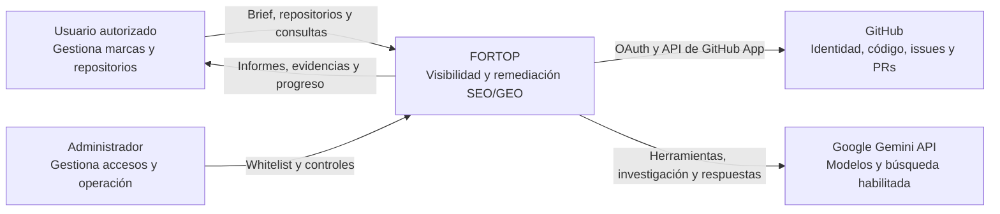
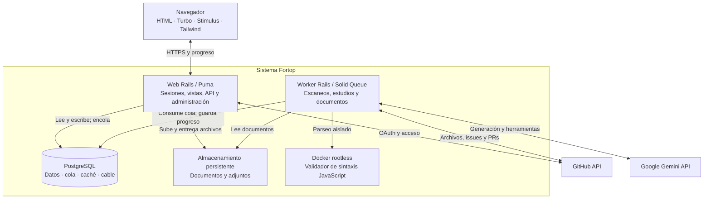
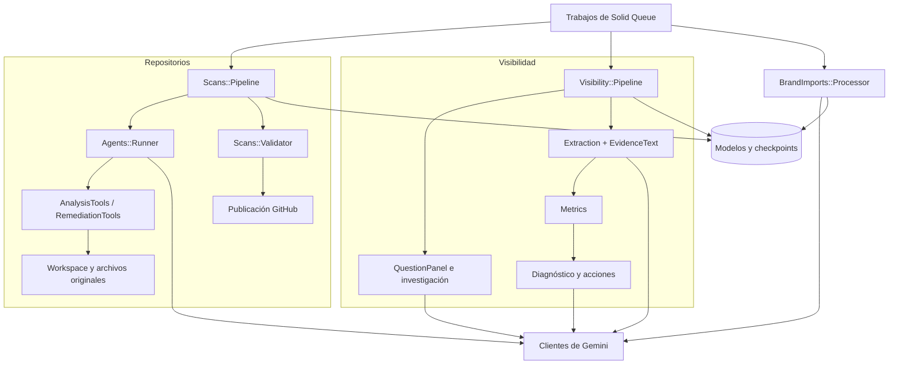
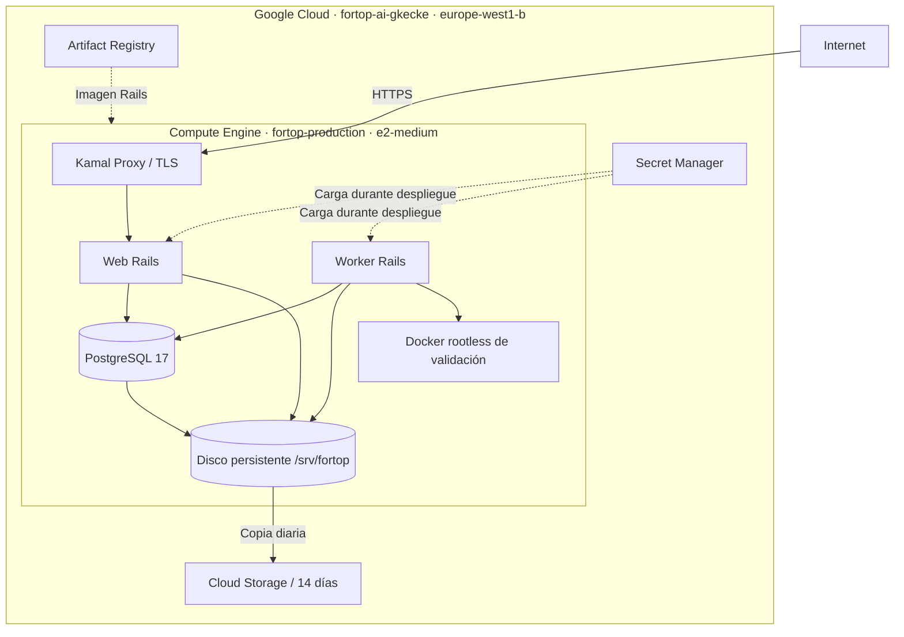

# Arquitectura de Fortop

[← Documentación](README.md) · [Desarrollo](desarrollo.md) · [Operación](operacion.md)

**Un monolito modular Rails, con web y worker separados, PostgreSQL y dos integraciones principales: GitHub y Gemini.** Los diagramas describen la implementación del repositorio, incluidos los dos verticales.

## C4 · Nivel 1 · Contexto

El usuario inicia sesión con GitHub. Los permisos sobre repositorios se comprueban antes de operar. El administrador se identifica por un ID estable de GitHub; la whitelist controla quién puede acceder a la plataforma.

## C4 · Nivel 2 · Contenedores

Web y worker ejecutan **la misma imagen de Rails** con roles distintos. Solid Queue usa PostgreSQL, sin Redis. `fortop_github_app/` contiene manifiesto y utilidades de registro; los callbacks se ejecutan en Rails.

## C4 · Nivel 3 · Componentes del worker

Los límites, cancelaciones y recuperaciones se comprueban alrededor de las tareas y llamadas. Los jobs usan persistencia y locks para coordinar trabajo; la configuración de producción procesa una ejecución simultánea por worker.

## Despliegue actual

Una sola VM aloja web, worker y base de datos. Es una configuración para el hackathon con persistencia y copias, sin alta disponibilidad. El DNS temporal depende de `sslip.io` y de la IP reservada.

## Datos y límites de confianza

| Dato o frontera | Tratamiento |
| :--- | :--- |
| Identidad y autorización | OAuth con state/PKCE; ID estable; acceso restringido por propietario |
| Tokens de usuario | Cifrados en PostgreSQL; renovación y comprobación de acceso |
| Escrituras en GitHub | Token efímero de instalación, limitado al repositorio; ramas `fortop/*` |
| Código y documentos externos | Se tratan como datos, sin autoridad para cambiar instrucciones |
| Briefs, investigación y respuestas | Active Record Encryption; versiones y evidencia persistentes |
| Documentos originales | Almacenamiento persistente; descarga autenticada por propietario |
| JavaScript analizado | Contenedor sin red, de solo lectura y con límites; sin ejecutar el proyecto |
| Credenciales de despliegue | Secret Manager; referencias en Kamal; fuera de Git |

## Mapa del código

| Área | Ubicación |
| :--- | :--- |
| Vistas, navegación e interacción | [views](../fortop_platform/app/views/) · [JavaScript](../fortop_platform/app/javascript/) |
| Identidad y GitHub App | [services/github](../fortop_platform/app/services/github/) |
| Agentes y ejecución de código | [services/agents](../fortop_platform/app/services/agents/) · [services/scans](../fortop_platform/app/services/scans/) |
| Investigación y medición de marca | [services/visibility](../fortop_platform/app/services/visibility/) |
| Documentos y autocompletado | [services/brand_imports](../fortop_platform/app/services/brand_imports/) |
| Administración | [services/admin](../fortop_platform/app/services/admin/) |
| Modelo y persistencia | [models](../fortop_platform/app/models/) · [db](../fortop_platform/db/) |
| Infraestructura y despliegue | [infra/gcp](../fortop_platform/infra/gcp/) · [deploy.yml](../fortop_platform/config/deploy.yml) |
