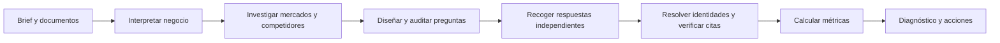

# Cómo medimos la visibilidad

[← Documentación](README.md) · [Ver producto](producto.md)

**Una muestra de respuestas verificables, vinculada a preguntas, mercados y una versión del brief.** El entorno medido es Gemini API con búsqueda habilitada; Google decide si ejecuta búsqueda en cada respuesta.

## Recorrido de un estudio

Cada estudio conserva el brief, el panel, el modelo, las tarifas y el método con los que comenzó. Editar la marca crea una versión nueva del contexto.

## Tres tipos de preguntas

| Tipo | Qué observa | Ejemplo de intención |
| :--- | :--- | :--- |
| Categoría | Descubrimiento entre proveedores de una categoría | Buscar una herramienta de gestión de turnos |
| Ajustada al cliente | Descubrimiento para un público, necesidad y ámbito concretos | Buscar una solución para una clínica pequeña en España |
| Con marca | Reconocimiento al preguntar por una marca concreta | Entender los servicios y encaje de esa marca |

Las preguntas sin marca deben pedir proveedores concretos y superar una auditoría de intención, encaje y neutralidad. Una revisión fallida permite una corrección antes de medir. El negocio puede ser local, regional o en línea: el alcance se toma del contexto investigado.

El brief, sus documentos y los competidores esperados **no se envían en las consultas independientes sin marca**. Las preguntas con marca quedan fuera del indicador principal y los tipos mantienen denominadores separados. Las preguntas generadas no equivalen a demanda de búsqueda observada.

## Detectar una marca exige contexto

La extracción semántica identifica nombres completos o parciales, siglas, nombres comerciales, aliases y errores ortográficos. Distingue menciones, comparaciones, recomendaciones y desaconsejar. Una coincidencia de texto o de dominio no basta para atribuir una respuesta a la empresa.

Cada atribución guarda el nombre observado, una cita y la razón de identificación. Los homónimos, matrices y filiales necesitan contexto suficiente; una identidad ambigua queda señalada para revisión.

Después, una comprobación determinista verifica la cita contra el **texto visible** de la respuesta:

- Interpreta Markdown/HTML y normaliza espacios, Unicode y tipografía.
- Conserva palabras, negaciones, cifras y contexto; rechaza paráfrasis presentadas como citas.
- Excluye nombres que solo estén en destinos de enlaces o contenido oculto.
- Permite una revisión adicional sobre la misma respuesta si la extracción aporta citas inválidas.

Los errores de evidencia restantes no se transforman en ausencias. Implementación: [EvidenceText](../fortop_platform/app/services/visibility/evidence_text.rb), [Evidence](../fortop_platform/app/services/visibility/evidence.rb) y [Extraction](../fortop_platform/app/services/visibility/extraction.rb).

## Cómo leer el informe

| Indicador | Significado |
| :--- | :--- |
| Presencia | Proporción de respuestas válidas que mencionan la marca |
| Recomendación | Proporción de respuestas válidas que la recomiendan |
| Citación propia | Respuestas válidas que citan un dominio propio verificable |
| Competencia | Presencia relativa de las marcas comparadas en ese panel |
| Consistencia | Variación entre repeticiones de las preguntas |
| Cobertura | Qué parte de la muestra prevista se ha podido evaluar |

Las [métricas](../fortop_platform/app/services/visibility/metrics.rb) se calculan en Ruby sobre la muestra válida. Las respuestas que dan consejos sin nombrar proveedores siguen contando; pendientes, fallidas o con identidad no verificable no se convierten en ceros. El informe muestra cobertura e incidencias para interpretar los porcentajes.

El diagnóstico cualitativo usa hasta 80 respuestas repartidas entre mercados y etapas, con referencias a la evidencia. Las métricas consideran la muestra válida completa.

## Qué se conserva

| Registro | Para qué sirve |
| :--- | :--- |
| Brief, documentos seleccionados e investigación | Entender el contexto exacto del estudio |
| Panel, instrucciones, modelo y configuración | Saber qué se preguntó y cómo |
| Respuestas, citas y fuentes | Revisar cada conclusión |
| Uso, reservas y tarifas | Explicar el consumo estimado |
| Versión de método y evidencia | Comparar solo estudios compatibles |

Briefs, investigación, prompts y respuestas se cifran en la base de datos. El pensamiento interno del proveedor no se persiste. Consultar o filtrar un informe guardado no genera llamadas de IA.

## Comparar en el tiempo

Reutiliza un panel completado con el mismo brief. La serie exige al menos dos muestras completas compatibles en panel, competidores, método, configuración, repeticiones, versiones del modelo y evidencia. Cambiar el brief requiere un panel nuevo.

Las acciones técnicas pueden enviarse a un repositorio del mismo usuario. Las editoriales y de posicionamiento permanecen como recomendaciones con seguimiento.

## Límites de interpretación

- Se mide **Gemini API**, no las interfaces de ChatGPT, Claude, Grok o Gemini para consumidores.
- La cuota de menciones del panel no es cuota de mercado, tráfico, volumen de búsquedas ni garantía de posicionamiento.
- El mercado aporta contexto a la pregunta; no simula una geolocalización real.
- Fuentes recuperadas y citas enlazadas a un fragmento son datos distintos. Se conserva la información devuelta por Google.
- Las discrepancias señaladas son candidatas a revisión, no errores probados de la marca.
- La resolución de identidades es general; los casos sin evidencia suficiente se muestran como inciertos.

[Presupuestos y recuperación →](operacion.md)
