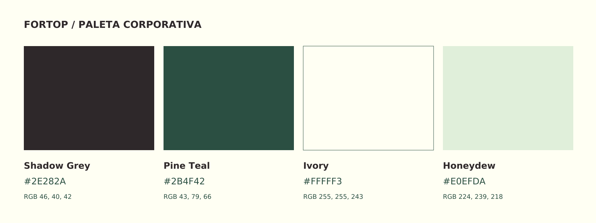

# Identidad de Fortop

**Ascenso + Sólido.** Símbolo arquitectónico y lettering original en una composición horizontal. Los maestros son SVG nativos con letras convertidas en trazados.

[Manual de marca](07_MANUAL/FORTOP_Manual_de_Marca.pdf) · [Sistema de un vistazo](07_MANUAL/FORTOP_brand_sheet.svg) · [Volver al proyecto](../README.md)

## Elegir el archivo

| Necesidad | Archivo o carpeta |
| :--- | :--- |
| Logo habitual sobre fondo claro | [Imagotipo a color transparente](03_IMAGOTIPO/FORTOP_imagotipo_color-transparente.svg) |
| Logo sobre fondo oscuro | [Imagotipo monocromo Ivory](03_IMAGOTIPO/FORTOP_imagotipo_mono-ivory.svg) |
| Símbolo independiente | [Isotipo Ascenso](01_ISOTIPO/FORTOP_isotipo_color-transparente.svg) |
| App icon, favicon o avatar | [05_DIGITAL](05_DIGITAL/) |
| Aplicaciones impresas y digitales | [06_APLICACIONES](06_APLICACIONES/) |
| PNG de un arte vectorial | [09_PREVISUALIZACIONES](09_PREVISUALIZACIONES/), con la misma estructura de carpetas |

## Paleta

| Shadow Grey | Pine Teal | Ivory | Honeydew |
| :--- | :--- | :--- | :--- |
| `#2E282A` | `#2B4F42` | `#FFFFF3` | `#E0EFDA` |

[Tokens CSS](08_PALETA/FORTOP_COLORES.css) · [Valores JSON](08_PALETA/FORTOP_PALETA.json)

## Usar y editar

- Conserva proporciones, separación y área de protección del manual.
- Usa los trazados originales: el lettering no se sustituye por una fuente genérica.
- Los PNG derivan de los SVG. Para escalar o preparar una aplicación nueva, parte del vector.
- Para impresión, añade el sangrado y aplica el perfil de color del proveedor; los HEX no incluyen equivalentes CMYK/Pantone aprobados.

## Originales y trazabilidad

| Carpeta | Contenido |
| :--- | :--- |
| [00_MAESTROS](00_MAESTROS/) | Geometría y composiciones maestras |
| [01_ISOTIPO](01_ISOTIPO/) · [02_LOGOTIPO](02_LOGOTIPO/) · [03_IMAGOTIPO](03_IMAGOTIPO/) | Firma principal y variantes |
| [04_ISOLOGO](04_ISOLOGO/) | Firma integrada secundaria |
| [07_MANUAL](07_MANUAL/) | Manual de 12 páginas y láminas vectoriales |
| [10_FUENTES](10_FUENTES/) | Código editable y dependencias para generar y exportar |
| [11_VALIDACION](11_VALIDACION/) | Comprobaciones e inventario con hashes |
| [99_REFERENCIAS](99_REFERENCIAS/) | Brief y referencias históricas, anteriores al kit final |

El [inventario de entrega](LEEME_PRIMERO.txt) conserva los detalles del kit original. El briefing dentro de `99_REFERENCIAS` describe el punto de partida, no el estado actual de los archivos finales.
