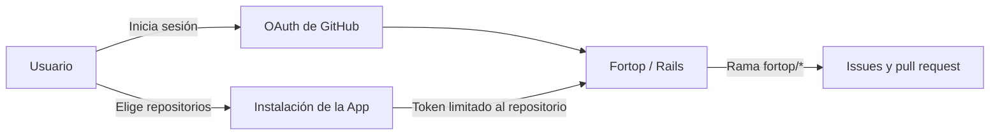

# GitHub App de Fortop

**Identidad para entrar; permisos de instalación para trabajar sobre el código.** Esta carpeta contiene el manifiesto, las utilidades de registro y el avatar. Los callbacks y la API se ejecutan en [Rails](../fortop_platform/README.md).

[Volver al proyecto](../README.md) · [Desarrollo](../docs/desarrollo.md) · [Operación](../docs/operacion.md)

## Registrar una instalación propia de Fortop

1. Arranca la plataforma con `bin/dev` desde `fortop_platform/`.
2. Abre **http://localhost:3000/setup/github** en el navegador local.
3. Pulsa **Registrar GitHub App** y confirma el registro con la cuenta de GitHub que será su propietaria.
4. El callback canjea el código y guarda las credenciales en `fortop_platform/.env`, con permisos `0600`. No se muestran en la página.
5. Inicia sesión con una cuenta autorizada en Fortop, instala la App y selecciona los repositorios desde **Conectar un repositorio**.

El registro está habilitado solo en desarrollo desde una conexión local y no reemplaza credenciales ya configuradas. La cuenta autenticada en la CLI `gh` no sustituye la identidad de los usuarios de la plataforma.

**Registrar la App no concede acceso a Fortop.** La whitelist y el administrador se configuran por separado; consulta [Desarrollo](../docs/desarrollo.md).

Los workers locales recargan las credenciales de GitHub guardadas por el registro. Al cambiar claves de Google u otras variables de agentes, reinicia `bin/dev`.

## Permisos

| Permiso | Nivel | Uso |
| :--- | :--- | :--- |
| Metadatos | Lectura | Identificar repositorios e instalaciones |
| Contenido | Escritura | Leer código y proponer cambios en ramas `fortop/*` |
| Issues | Escritura | Publicar hallazgos |
| Pull requests | Escritura | Abrir propuestas para revisión |
| Webhooks | Desactivados | La autorización se comprueba antes de operar |

El manifiesto deja vacía la URL del webhook; una URL `localhost` provoca errores de registro incluso con el hook desactivado. Los usuarios eligen todos sus repositorios o un subconjunto al instalar la App.

OAuth usa `state`, PKCE y tokens de usuario renovables. Cada trabajo verifica el acceso vigente y obtiene un token de instalación efímero limitado al repositorio. Fortop no fusiona los PRs.

## URLs y credenciales

`APP_URL` define el origen de la plataforma. Configura estas rutas con el mismo origen en GitHub:

| Campo | Ruta |
| :--- | :--- |
| Homepage URL | El origen de `APP_URL` |
| Callback OAuth | `/auth/github/callback` |
| Setup URL de instalación | `/github/installations/callback` |
| Callback del registro por manifiesto | `/github/app/manifest/callback`, solo durante el registro local |

La demo de producción se retiró el **22 de octubre de 2026** y sus instalaciones de GitHub quedaron suspendidas. Para una nueva instancia, configura su propio origen; no reutilices la antigua URL de `sslip.io`. Puede conservarse también el callback de localhost. El registro `/setup/github` permanece deshabilitado en producción.

El registro completa `GITHUB_APP_ID`, `GITHUB_APP_SLUG`, `GITHUB_CLIENT_ID`, `GITHUB_CLIENT_SECRET`, `GITHUB_APP_PRIVATE_KEY` y `GITHUB_WEBHOOK_SECRET`. La clave privada se guarda en base64 para conservar el PEM; el servidor también acepta el PEM al configurar variables directamente.

Desde esta carpeta, `./bin/manifest` muestra el manifiesto público con las URLs actuales, sin credenciales. `./bin/setup` arranca solo Rails en loopback; para trabajar con los agentes usa `bin/dev` en la plataforma.

## Avatar e identidad de publicación

El autor de los PRs es el bot de la GitHub App. En la [configuración de fortop-app](https://github.com/settings/apps/fortop-app), selecciona **Display information → Upload a logo**, usa [`avatar.png`](avatar.png) y guarda el nuevo avatar. El fondo de marca es `#FFFFF3`.

El avatar se configura en GitHub, independientemente del logo mostrado por Rails.

## Código relacionado

[Servicios de GitHub](../fortop_platform/app/services/github/) · [Controladores de registro e instalación](../fortop_platform/app/controllers/github/) · [Sesiones](../fortop_platform/app/controllers/sessions_controller.rb)
