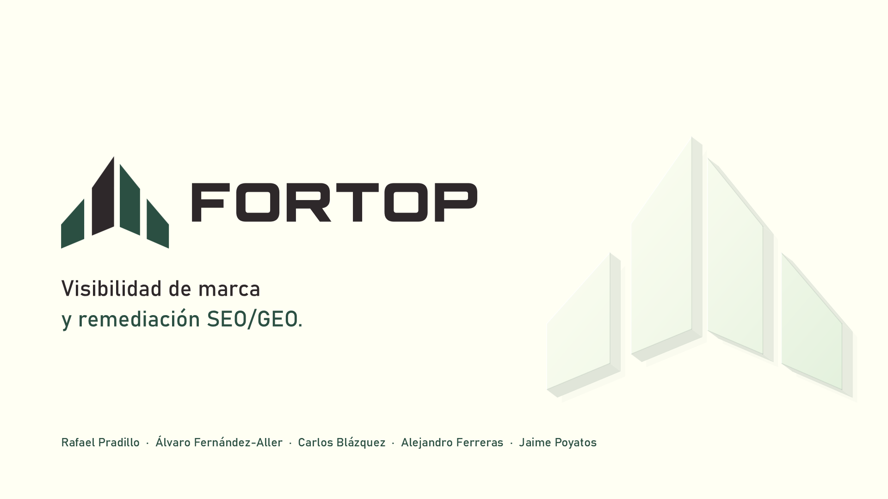

# Pitch de Fortop

[](Fortop-Pitch.pdf)

**3 minutos de presentación + 1 minuto de demo. Español · 16:9 · 8 diapositivas.**

[Abrir PDF](Fortop-Pitch.pdf) · [Descargar PowerPoint editable](Fortop-Pitch.pptx) · [Ver capturas](../docs/producto.md) · [Volver al proyecto](../README.md)

**Demo cerrada el 22 de octubre de 2026.** La presentación conserva la versión del hackathon; el enlace de demo que aparece en sus archivos ya no está activo.

## Recorrido

| # | Diapositiva | Mensaje | Tiempo |
| :--- | :--- | :--- | ---: |
| 01 | [Portada](slides/01-portada.png) | Visibilidad de marca y remediación SEO/GEO | 10 s |
| 02 | [Problema](slides/02-problema.png) | Tus clientes piden recomendaciones. ¿Aparece tu marca? | 25 s |
| 03 | [Insight](slides/03-insight.png) | La visibilidad depende de contenido y base técnica | 20 s |
| 04 | [Solución](slides/04-solucion.png) | Fortop conecta medición de marca y mejora del código | 25 s |
| 05 | [Cómo funciona](slides/05-agentes.png) | Agentes, herramientas y validación en dos recorridos | 35 s |
| 06 | [Producto](slides/06-producto.png) | Acceso directo a la demo | 25 s |
| 07 | [Cliente y negocio](slides/07-negocio.png) | Pequeños SaaS sin equipo SEO; suscripción por volumen | 25 s |
| 08 | [Cierre](slides/08-cierre.png) | Entiende tu visibilidad. Mejora tu web. | 15 s |

**Total: 180 segundos.** Las notas del PowerPoint contienen el guion. El modelo comercial es una propuesta; no implica ventas o precios validados.

## Antes de presentar

Para volver a presentar con una demo, prepara una instancia propia con una marca y un repositorio con resultados y actualiza el enlace de la diapositiva 6 antes de exportar. La demo de un minuto se cuenta aparte del pitch.

## Editar y exportar

| Ruta | Contenido |
| :--- | :--- |
| `Fortop-Pitch.pptx` | Presentación con texto editable y gráficos vectoriales |
| `Fortop-Pitch.pdf` | Exportación lista para compartir |
| `slides/` | Cada diapositiva en SVG, PNG y PDF |
| `assets/` | Recursos por diapositiva y atribuciones de marcas externas |
| `src/build_pitch.py` | Composición, textos, tiempos y notas |
| `src/export_powerpoint.py` | Exportación nativa con PowerPoint instalado en Windows |

Desde la raíz del repositorio, crea el entorno fuera de los archivos versionados:

```sh
python3 -m venv /tmp/fortop-pitch-venv
/tmp/fortop-pitch-venv/bin/pip install -r fortop_pitch/src/requirements.txt
/tmp/fortop-pitch-venv/bin/python fortop_pitch/src/build_pitch.py
```

La generación requiere Cairo y las fuentes Bahnschrift y Consolas instaladas. En WSL usa sus rutas de Windows por defecto; puedes indicarlas con `FORTOP_PITCH_FONT` y `FORTOP_PITCH_CODE_FONT`. Las fuentes no se distribuyen en el repositorio.

Para que PDF y PNG coincidan con el PowerPoint final, en WSL con PowerPoint de Windows y `qpdf` disponibles:

```sh
/tmp/fortop-pitch-venv/bin/python fortop_pitch/src/export_powerpoint.py
```

Revisa las ocho diapositivas después de regenerar: el comando reemplaza las exportaciones. La paleta y los logos parten del [brand kit](../fortop_brand_kit/README.md).

## Equipo

Rafael Pradillo · Álvaro Fernández-Aller · Carlos Blázquez · Alejandro Ferreras · Jaime Poyatos.
